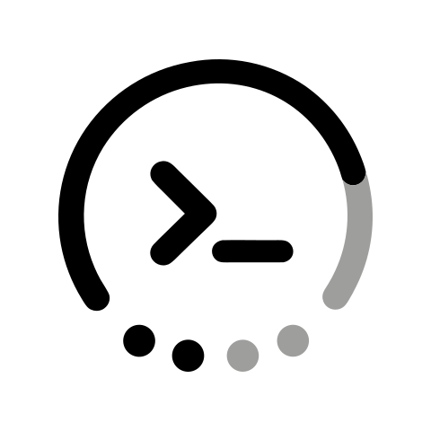
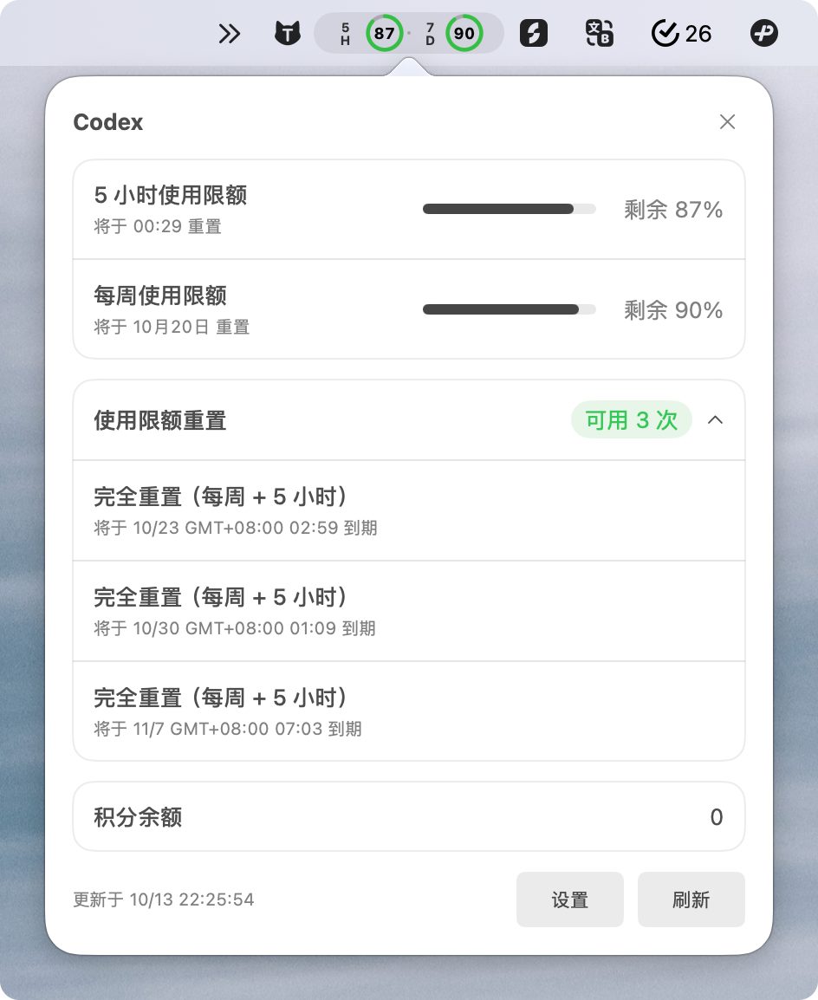
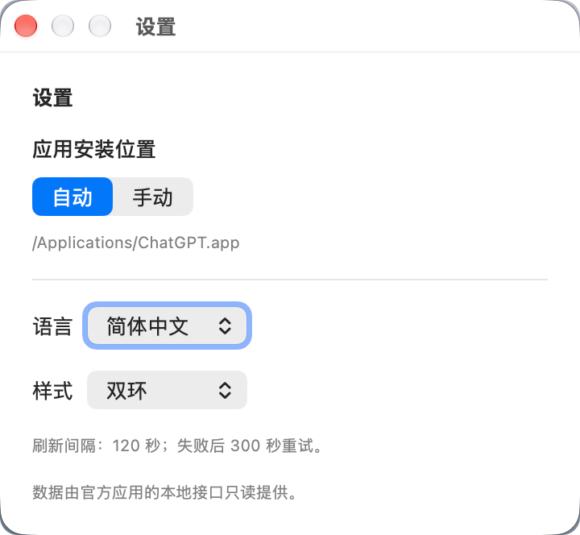
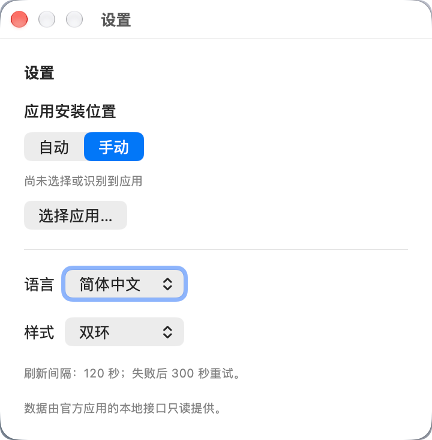

# Codex Dosage



English · [简体中文](README.zh-CN.md)

A lightweight macOS menu-bar companion for Codex: check your 5-hour and weekly quotas, reset times, available usage resets, and credit balance at a glance.

Based on [tollenceld/codex-usage-status](https://github.com/tollenceld/codex-usage-status), with a redesigned usage panel, bilingual settings, and support for both ChatGPT and Codex application bundles. Independent third-party software; not affiliated with or endorsed by OpenAI.

## Features

- **Menu-bar status:** compact double rings show remaining 5-hour and weekly quotas; a larger readout is available in Settings.
- **Usage panel:** left-click to see quota bars, reset times, available reset-card count and expiration dates. Credit balance appears when the official interface provides it. Right-click for Settings, Refresh, and Quit.
- **Read-only resets:** displays reset cards without consuming them or changing account limits.
- **Application discovery:** automatically finds supported ChatGPT/Codex bundles by identity and structure. Manual mode lets you choose a custom installation location; renamed bundles and paths with spaces are supported.
- **Languages:** System default, Simplified Chinese, or English, with immediate switching and saved preferences.
- **Refresh:** normally every 120 seconds; retry after 300 seconds on failure. Keeps the last successful data and its timestamp. Missing quota values are shown as unknown.
- **Native UI:** AppKit/SwiftUI popover with compact system typography, dark-mode support, and an original terminal-inspired icon.

## Screenshots

### Usage panel



### Settings: automatic and manual discovery




Screenshots show example account values; your quotas, reset cards, dates, and balance may differ.

## Install V0.1.0

Download [Codex-Dosage-0.1.0-macos-arm64.zip](https://github.com/zhengzhi-me/codex-dosage/releases/download/V0.1.0/Codex-Dosage-0.1.0-macos-arm64.zip) from [Releases](https://github.com/zhengzhi-me/codex-dosage/releases).

1. Quit any previous version, unzip, and move **Codex Dosage.app** into Applications.
2. Open the app. It runs in the menu bar and does not appear in the Dock.
3. Sign in through the official ChatGPT/Codex app. Use manual discovery if needed.

Requires **macOS 13+** and a supported official desktop app. This release contains an **Apple Silicon (arm64)** build. Intel users can build from source; an Intel binary is not included or runtime-tested in V0.1.0.

The download is ad-hoc signed and is not Apple-notarized, so macOS may show a security warning. Existing app preferences are preserved. If you used an older login item, update it to the renamed app.

## Data source and privacy

Codex Dosage invokes the official app bundle's `app-server` through local standard input/output and calls `account/rateLimits/read`. It does not scrape the screen, read authentication files, or send telemetry. **The official server may use the network to fetch current account data; local IPC does not imply offline operation.** On refresh failure the last successful data remains visible.

Reset cards and balances depend on the fields returned by the official interface. No card consumption, credit purchase, account switching, or login operation is performed. See [PRIVACY.md](PRIVACY.md) and [SECURITY.md](SECURITY.md).

## Build and CLI

Use Swift 6+ / Xcode Command Line Tools; Node.js 20+ is needed for tests and the optional CLI.

```sh
npm test
npm run test:macos
npm run build:macos
npm run start:macos
```

The app is generated at `dist/Codex Dosage.app`. To create a release ZIP, run `npm run package:macos`. `BUILD_ARCH=x86_64` selects an Intel build. With standalone Command Line Tools, use `DEVELOPER_DIR=/Library/Developer/CommandLineTools`. Xcode license acceptance must be completed by the user if prompted.

```sh
npm run usage -- --lang=en
npm run usage:json
npm run usage -- --app="/Applications/ChatGPT.app"
```

Development overrides: `CODEX_BIN` for an executable, `CODEX_APP` for a bundle, and `CODEX_USAGE_REFRESH_SECONDS` for the refresh interval (minimum 60 seconds). Demo mode is explicit: `CODEX_USAGE_DEMO=1`; normal runs use account data.

## Credits and license

- Upstream: [tollenceld/codex-usage-status](https://github.com/tollenceld/codex-usage-status). Original copyright and [MIT license](LICENSE) are preserved.
- Application icon: user-provided SVG/PNG, with a terminal symbol adapted from [Lucide terminal](https://lucide.dev/icons/terminal). Related ISC/MIT notices are included in [licenses/Lucide-LICENSE](licenses/Lucide-LICENSE).
- Modifications: application discovery, bilingual UI, usage/reset-card panel, refresh status, icon, and packaging.

OpenAI, ChatGPT, and Codex names and trademarks belong to their respective owners. Earlier local development versions are recorded in [development history](docs/development-history.md); **V0.1.0** starts the independent Codex Dosage release series.
